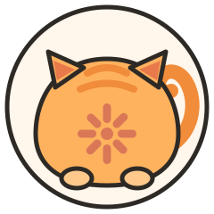

<div align="center">



# tigang-reminder · 提肛提醒

**每一次 `git commit` / `git push`,终端都会提醒你做一组提肛运动。**

A Kegel-exercise reminder that fires on every git commit / push —
for humans who code with agents.


**Claude Code** · **Codex CLI** · **pi** · **dsh** —— 四个 agent 共享同一份统计

[English](README.md) · **简体中文**

</div>

---

## 为什么

程序员久坐办公,盆底肌长期受压、血液循环变差。提肛运动(凯格尔运动)可以锻炼盆底肌,有助于预防痔疮、改善局部血液循环,而且随时随地、不动声色就能做。

把提醒挂在 commit / push 上,恰好是工作节奏里天然的"课间铃"—— 你反正要停下来等 agent 干活,顺手来一组。

**为什么是 hook,而不是让 AI"记得提醒你"?** hook 由终端在工具调用时**确定性执行**,不依赖模型的自觉。让模型自己想起来的提醒,和你的 New Year's resolution 一样可靠。

## 工作原理:提醒追加在 AI 回答末尾,零 token

```
agent 执行 Bash: git commit / git push
        │
        ▼
检测阶段(PostToolUse / tool_result)         ← core.detect(command, output)
        ├─ 正则识别 git commit / git push(支持 git -C path commit、
        │  cd x && git push、commit && push 等变体;先剥掉引号内内容,
        │  避免"字符串里提到 git push"被误判)
        ├─ nothing to commit / push rejected / fatal 等无效操作不计数
        ├─ 次数累计写入 ~/.claude/tigang-reminder/stats.json
        ├─ 把待提醒写入 pending.json(同回合多次触发会合并,30 分钟 TTL)
        └─ 不产生任何 stdout → 不进入模型上下文,零 token 消耗
        │
        ▼  ……agent 继续工作、生成完整回答……
        │
回合结束(Stop / agent_settled / turn end)   ← core.takePendingMessage()
        └─ 提醒由终端在显示层渲染,出现在 AI 回答的末尾
           (systemMessage / ui.notify / ANSI tty,不经过模型,零 token)
```

让模型"说出"提醒虽然自然,但每次 commit 都注入上下文 + 生成文字,持续烧 token;
显示层追加**看起来**像 AI 回答的一部分,实际上完全绕过模型。

### 零上下文污染 —— 按设计保证

| 阶段 | 做了什么 | 进模型上下文? |
| --- | --- | --- |
| 检测(PostToolUse / tool_result) | 读工具载荷、写本地 JSON —— **零 stdout** | 无 |
| 提醒(回合结束) | `systemMessage` / `ui.notify` / ANSI tty —— 纯显示层渲染 | 无 |
| 任何异常 | 静默 `exit 0`,绝不阻塞 git 或会话 | 无 |

仅有的两条能触达模型的通道 —— hook 的 stdout、Stop hook 的 `decision: "block"` reason —— 都刻意未用。唯一的上下文足迹是 `/tigang-stats` 命令的静态一行描述,命令正文只在你主动调用时才加载。

## 安装

### 懒得复制命令?直接把链接丢给 AI

把下面这段贴进你正在用的 agent 对话框 —— Claude Code、Codex CLI、pi、dsh 都行,它会自己读本 README、选对应用自己的装法,装完还会告诉你怎么验证:

```text
帮我安装 tigang-reminder 插件,仓库:https://github.com/TardisBooo/tigang-plugin
按 README 里针对你所用 agent 的说明安装,装完告诉我怎么验证生效。
```

### Claude Code(原生插件)

```bash
git clone https://github.com/TardisBooo/tigang-plugin.git
claude plugin marketplace add /path/to/tigang-plugin
claude plugin install tigang-reminder@tigang
```

已运行的旧会话执行一次 `/reload-plugins --force` 即可激活,无需重启。

### Codex CLI(0.152+)

在 `~/.codex/config.toml` 末尾追加两个 hook,并在交互会话里执行一次 `/hooks` 完成信任。
完整配置见 **[adapters/codex/README.md](adapters/codex/README.md)**。

### pi(@earendil-works/pi-coding-agent)

```bash
cp adapters/pi/tigang-reminder.ts ~/.pi/agent/extensions/
cp core/tigang_core.js ~/.pi/agent/extensions/
```

详见 **[adapters/pi/README.md](adapters/pi/README.md)**。

### dsh(DeepSeek Harness)

依赖社区插件 `dsh-plugin-hooks`,把 `adapters/dsh/hooks.json` 的内容合并进 `$DSH_HOME/hooks.json`。
详见 **[adapters/dsh/README.md](adapters/dsh/README.md)**。

> 各安装方式会动哪些文件、如何卸载,统一列在 **[INSTALL.md](INSTALL.md)**。

## 使用

- 正常让 agent 提交、推送代码即可触发,无需任何额外操作。
- 查看统计:Claude Code 会话里输入 `/tigang-stats`,或直接看
  `~/.claude/tigang-reminder/stats.json`。
- 四个 agent 共享同一份统计(今日次数 / 累计次数 / commit 与 push 各多少)。
- 提醒语言自动跟随系统语言:**简体中文 / 繁體中文 / English / 日本語 / 한국어 / Español**;
  环境变量 `TIGANG_LANG` 可强制指定(如 `TIGANG_LANG=en`),未覆盖语言回退英文。
- 测试或隔离:环境变量 `TIGANG_STATE_DIR` 重定向状态目录。

## 防误报设计

- 命令按 `&&`、`||`、`;`、`|`、换行分段,逐段匹配 `git [全局选项] commit|push`
- 匹配前先剥离单/双引号内的内容 —— `git commit -m "提及 push 的文案"` 不会误报
- 输出含 `nothing to commit`、`! [rejected]`、`fatal:` 等视为无效操作,不计数
- 命令失败(非零退出码 / `isError`)不计数

## FAQ

**会消耗 token 吗?** 不会。检测阶段零输出;提醒在回合结束时由终端在显示层渲染,模型全程无感知。

**隐私?** 零网络请求。所有代码只读写本地 `~/.claude/tigang-reminder/` 下的两个 JSON 文件。

**多个会话 / 多个 agent 同时用?** 统计与待提醒全局共享 —— 一个全局健康计数器 😄

**我自己在终端手动 commit 也想被提醒?** 给 git 配全局 post-commit 模板钩子:

```bash
git config --global init.templatedir ~/.git-template
mkdir -p ~/.git-template/hooks
printf '#!/bin/sh\necho "💪 [提肛提醒] 又一次 commit!收紧3秒→放松3秒,重复10次"\n' > ~/.git-template/hooks/post-commit
chmod +x ~/.git-template/hooks/post-commit
```

(只对之后新 clone/init 的仓库生效;现有仓库需手动复制该钩子。)

## 目录结构

```
tigang-plugin/
├── .claude-plugin/
│   ├── plugin.json          # Claude Code 插件清单
│   └── marketplace.json     # marketplace(单插件仓库,source: "./")
├── core/
│   └── tigang_core.js       # 共享核心:检测正则 / 统计 / pending / 文案(零依赖)
├── hooks/
│   ├── hooks.json           # Claude Code:PostToolUse(Bash)+ Stop
│   └── tigang_hook.js       # 入口脚本(detect / remind 两模式)
├── adapters/
│   ├── codex/README.md      # Codex CLI:config.toml 注册,复用同一入口脚本
│   ├── dsh/                 # dsh:dsh_detect.js / dsh_remind.js / hooks.json
│   └── pi/tigang-reminder.ts# pi 扩展:tool_result 检测 + agent_settled 渲染
├── commands/
│   └── tigang-stats.md      # /tigang-stats 查看统计
├── tests/
│   └── test_core.js         # npm test
└── docs/
    └── logo.svg             # logo(猫屁股 × 星芒)
```

## 贡献 & 许可证

- 新增 agent 适配器的指南见 [CONTRIBUTING.md](CONTRIBUTING.md) —— 核心模式只有两个函数。
- 单元测试:`npm test`(零依赖,< 5 秒)。
- [CHANGELOG.md](CHANGELOG.md) · [SECURITY.md](SECURITY.md) · [INSTALL.md](INSTALL.md)
- MIT License © 2026 TardisBooo

---

<div align="center">

**现在就来一组:收紧 3 秒 → 放松 3 秒,重复 10 次,自然呼吸不要憋气。** 💪

</div>
